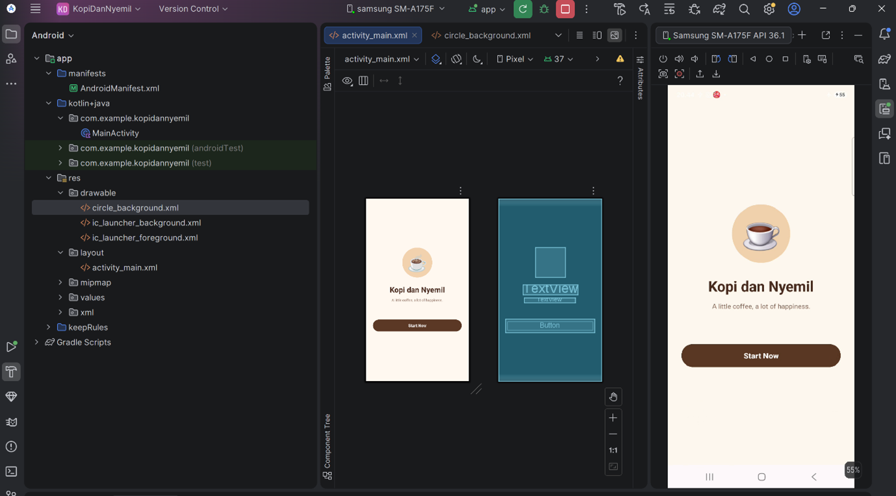
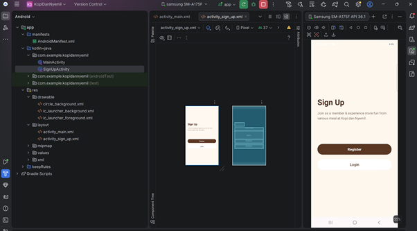
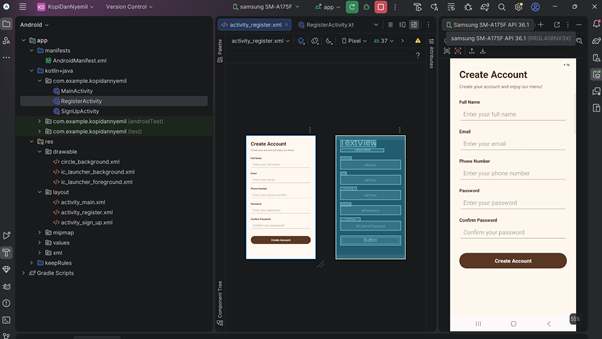
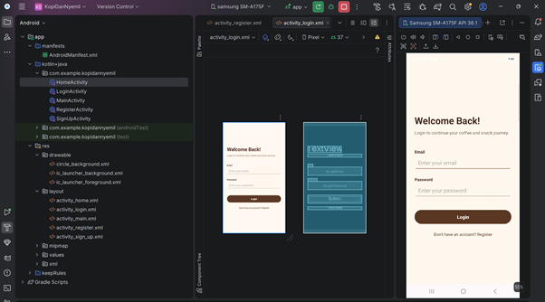
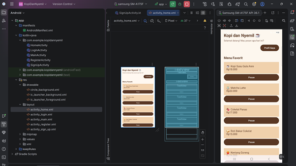
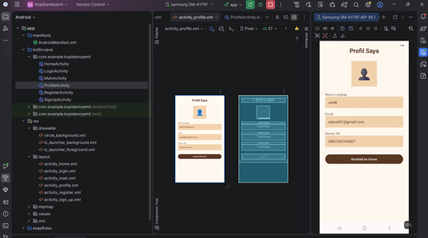
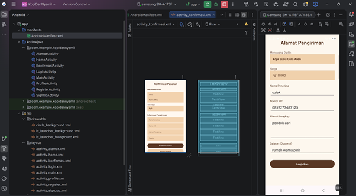
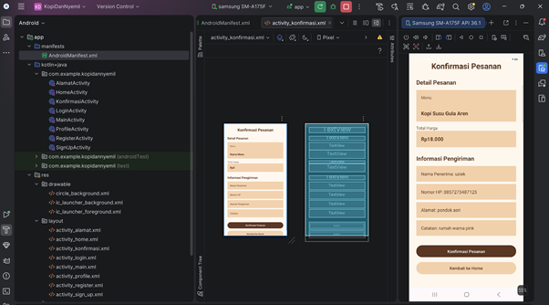

# ☕ Kopi dan Nyemil

*A little coffee, a little snack, and a lot of happiness.*

Aplikasi mobile sederhana untuk pemesanan kopi dan camilan. Project ini dibuat untuk memenuhi tugas mata kuliah **Pengembangan Aplikasi Mobile**.

---

## ✦ Identitas Pengembang

| Informasi | Keterangan |
|---|---|
| Nama | Uziek Rimbawati Bilqs |
| NIM | 1247050037 |
| Kelas | D |

## ☕ Tentang Aplikasi

**Kopi dan Nyemil** merupakan aplikasi pemesanan makanan dan minuman yang menyediakan berbagai pilihan kopi dan camilan. Pengguna dapat melakukan registrasi, login, melihat menu, mengakses profil, mengisi alamat pengiriman, hingga melakukan konfirmasi pesanan.

## ✧ Fitur Aplikasi

- 🏠 **Splash / Welcome** — Halaman pembuka aplikasi.
- ✦ **Sign Up** — Pilihan untuk registrasi atau login.
- 📝 **Register** — Formulir pendaftaran akun pengguna.
- 🔐 **Login** — Masuk menggunakan email dan password.
- ☕ **Home** — Menampilkan pilihan menu makanan dan minuman.
- 👤 **Profile** — Menampilkan informasi profil pengguna.
- 📍 **Alamat Pengiriman** — Mengisi data penerima dan alamat pengiriman.
- 🧾 **Konfirmasi Pesanan** — Menampilkan ringkasan pesanan sebelum dikonfirmasi.

## 🛠️ Teknologi

- Kotlin
- XML Layout
- Android Studio
- SharedPreferences

## 📸 Dokumentasi Aplikasi

### 01 · Splash / Welcome

### 02 · Sign Up

### 03 · Register

### 04 · Login

### 05 · Home

### 06 · Profile

### 07 · Alamat Pengiriman

### 08 · Konfirmasi Pesanan

## 🚀 Cara Menjalankan Aplikasi

1. Clone repository ini atau download project dari GitHub.
2. Buka project menggunakan Android Studio.
3. Tunggu proses Gradle Sync hingga selesai.
4. Jalankan aplikasi melalui emulator atau perangkat Android.

---

  ☕ <i>Made with care, coffee, and a little creativity.</i>

